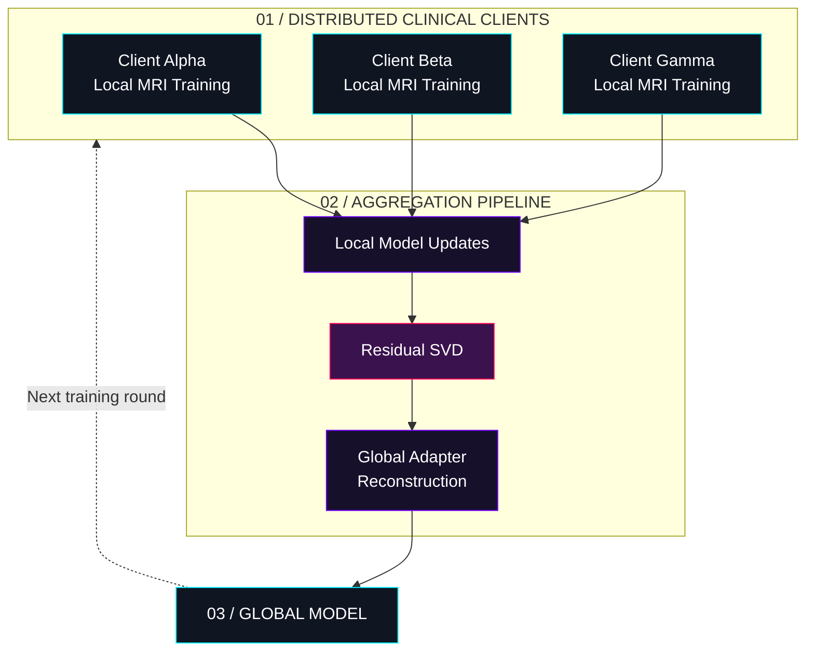

<!-- Shaswata28/Shaswata28 — Cyber-Industrial Engineering Dashboard -->

<div align="center">


<br/>

<a href="https://github.com/Shaswata28">

</a>

<br/>

<a href="https://github.com/Shaswata28">

</a>
<a href="https://github.com/Shaswata28?tab=repositories">

</a>
<a href="https://github.com/Shaswata28?tab=followers">

</a>


<br/><br/>

<code>SOFTWARE ENGINEERING</code> &nbsp; <code>AI RESEARCH</code> &nbsp; <code>SYSTEMS THINKING</code>

<br/><br/>

<a href="#research-lab">RESEARCH</a> &nbsp; // &nbsp;
<a href="#project-archives">PROJECTS</a> &nbsp; // &nbsp;
<a href="#technical-stack">TECH STACK</a> &nbsp; // &nbsp;
<a href="#github-telemetry">GITHUB TELEMETRY</a>

</div>

---

## `00` / OPERATOR PROFILE

```text
┌──────────────────────────────────────────────────────────┐
│  USER       : Shaswata Das                               │
│  ROLE       : Software Engineer / AI-ML Researcher       │
│  INSTITUTION: East Delta University                      │
│  DEGREE     : B.Sc. in Computer Science                  │
│  INTERESTS  : Distributed AI, Product Engineering        │
│               Local LLMs, Automation, Systems Design     │
├──────────────────────────────────────────────────────────┤
│  DIRECTIVE                                               │
│  Turn ambitious ideas into useful, working systems.     │
└──────────────────────────────────────────────────────────┘
```

I build across the boundary between software engineering and applied AI — from full-stack applications and mobile products to privacy-preserving machine learning and locally orchestrated AI workflows.

I enjoy understanding how systems work, finding the bottlenecks, and engineering practical solutions rather than stopping at the prototype.

---

<a id="research-lab"></a>

## `01` / RESEARCH LAB

<details open>
<summary><strong>01.A — Federated Medical AI</strong></summary>

### Privacy-Preserving Glioma Segmentation

<code>FEDERATED LEARNING</code> <code>MEDICAL VLMs</code> <code>NON-IID DATA</code> <code>RESIDUAL SVD</code>

Investigating communication-efficient federated learning for multimodal brain MRI segmentation across heterogeneous clinical clients, exploring LLaVA-Med, MedGemma, parameter-efficient adaptation, and Residual SVD-based aggregation.

| Research component | Approach |
|---|---|
| Clinical data | BraTS multimodal brain MRI |
| Distributed training | Federated learning across non-IID clients |
| Model adaptation | LoRA / parameter-efficient fine-tuning |
| Aggregation | Residual SVD and low-rank updates |
| Primary objective | Communication efficiency and privacy-aware collaboration |



*Architecture illustration — conceptual workflow, not a claim of a deployed clinical system. Federated learning alone does not guarantee privacy; that depends on the implementation and additional safeguards.*

</details>

---

<a id="project-archives"></a>

## `02` / PROJECT ARCHIVES

<text>Selected engineering projects spanning campus fintech, event management, mobile productivity, and applied AI.</text>

<table>
<tr>
<td width="50%" valign="top">

### `01` / EDU-COIN

**Campus Digital Token Ledger**

<code>REACT</code> <code>NODE.JS</code> <code>SUPABASE</code>

A university payment ecosystem for student wallets, campus purchases, vendor transactions, and administrative analytics.

[↗ Explore repository](https://github.com/Shaswata28/EDU-COIN)

</td>
<td width="50%" valign="top">

### `02` / EVENTFLOW CRM

**Event Operations Engine**

<code>FULL-STACK</code> <code>DATABASES</code> <code>CRM</code>

An event-management platform designed to organize stakeholder pipelines, scheduling, team coordination, and event operations.

[↗ Explore repositories](https://github.com/Shaswata28?tab=repositories)

</td>
</tr>
<tr>
<td width="50%" valign="top">

### `03` / STUDYMATE

**AI-Powered Learning Workspace**

<code>RAG</code> <code>LLMs</code> <code>LOCAL AI</code>

A learning assistant concept combining document retrieval, course organization, and AI-powered study workflows with local and hosted models.

[↗ Explore repositories](https://github.com/Shaswata28?tab=repositories)

</td>
<td width="50%" valign="top">

### `04` / FED-MEDVLM

**Federated Medical AI Research**

<code>PYTORCH</code> <code>LoRA</code> <code>SVD</code>

Research into communication-efficient federated training and multimodal brain tumor segmentation under heterogeneous client distributions.

[↗ Explore repositories](https://github.com/Shaswata28?tab=repositories)

</td>
</tr>
<tr>
<td width="50%" valign="top">

### `05` / MOMENTUM

**Student Life OS**

<code>FLUTTER</code> <code>DART</code> <code>MOBILE</code>

A mobile productivity concept focused on routines, habit tracking, personal organization, and financial activity.

[↗ Explore repositories](https://github.com/Shaswata28?tab=repositories)

</td>
<td width="50%" valign="top">

### `06` / LENS-E UTHSOB 2.0

**National Photography Exhibition Portal**

<code>WEB ENGINEERING</code> <code>EVENT TECH</code>

A digital portal supporting photography contest submissions and event operations for a national photography exhibition.

[↗ Explore repositories](https://github.com/Shaswata28?tab=repositories)

</td>
</tr>
</table>

---

## `03` / ENGINEERING PRINCIPLES

<details>
<summary><strong>How I approach building systems</strong></summary>

- **Understand the system first.** Identify constraints, dependencies, and failure points before adding complexity.
- **Build for actual workflows.** Design around what users need to accomplish, not just what looks impressive in a demo.
- **Keep data and infrastructure deliberate.** Choose architectures based on maintainability, reliability, and deployment requirements.
- **Experiment with local AI.** Explore practical ways to run, orchestrate, and integrate language models.
- **Measure before claiming.** Distinguish working implementations, experiments, and future objectives.

</details>

---

<a id="technical-stack"></a>

## `04` / TECHNICAL STACK

<table>
<tr>
<td width="28%" valign="top"><strong>LANGUAGES</strong></td>
<td valign="top">


</td>
</tr>
<tr>
<td valign="top"><strong>WEB & MOBILE</strong></td>
<td valign="top">


</td>
</tr>
<tr>
<td valign="top"><strong>DATA & BACKEND</strong></td>
<td valign="top">


</td>
</tr>
<tr>
<td valign="top"><strong>AI & RESEARCH</strong></td>
<td valign="top">


</td>
</tr>
<tr>
<td valign="top"><strong>INFRASTRUCTURE</strong></td>
<td valign="top">


</td>
</tr>
</table>

---

<a id="github-telemetry"></a>

## `05` / GITHUB TELEMETRY

<div align="center">


<br/><br/>


<br/><br/>


</div>

---

## `06` / CURRENT OPERATING DIRECTIVES

```text
[01] RESEARCH
     Explore federated medical AI and efficient model adaptation.

[02] ENGINEERING
     Build maintainable web and mobile applications.

[03] LOCAL AI
     Experiment with LLM inference, retrieval, and automation.

[04] SYSTEMS
     Understand deployment, infrastructure, and performance.
```

---

<div align="center">

### `BUILD INTENTIONALLY. UNDERSTAND DEEPLY. SHIP USEFUL THINGS.`

<code>END OF TRANSMISSION // SHASWATA28</code>

<br/><br/>

<a href="https://github.com/Shaswata28">

</a>

</div>
