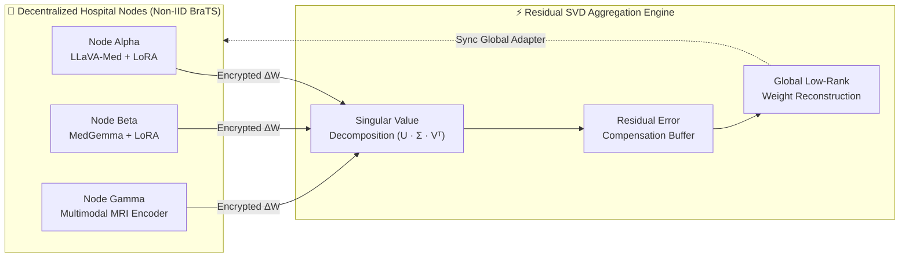

<!-- Shaswata28/Shaswata28 — Cyber-Industrial Telemetry & Research README -->

<div align="center">

<!-- HEADER BANNER -->


<br/>

<!-- TERMINAL TYPING SVG -->
<a href="https://github.com/Shaswata28">
  
</a>

<br/><br/>

<!-- STATUS BADGES -->
<a href="https://github.com/Shaswata28">
  
</a>
<a href="https://github.com/Shaswata28?tab=repositories">
  
</a>
<a href="https://github.com/Shaswata28?tab=followers">
  
</a>


<br/><br/>


</div>

## `01` // NEOFETCH_DIAGNOSTICS & OPERATOR_PROFILE

```text
shaswata@fedora-ai-rig
────────────────────────────────────────────────────
OS_KERNEL      ▸ Fedora Linux x86_64 (Custom GPU & Bash Pipelines)
INSTITUTION    ▸ East Delta University (B.Sc. in CS)
RESEARCH       ▸ Federated VLMs · Residual SVD · BraTS 3D MRI
BACKBONES      ▸ LLaVA-Med · MedGemma · LoRA / PEFT Adapters
FULL_STACK     ▸ Next.js · Flutter · React Native · Supabase
AUTOMATION     ▸ Docker · n8n Autonomous Agents · Local Ollama
CREATIVE_OPS   ▸ DaVinci Resolve · Motion Systems · Visual Direction

⚡ MISSION_DIRECTIVE:
Bridging decentralized clinical AI research with
high-concurrency, production-grade software systems.
```

## `02` // RESEARCH_ARCHITECTURE: FEDERATED MEDICAL AI

| 🧬 THESIS DOMAIN | 🏥 CLINICAL DATA | ⚡ OPTIMIZATION ENGINE | 🧠 BACKBONE VLMs |
|---|---|---|---|
| `Privacy-Preserving AI` | `Non-IID BraTS 3D MRI` | `Residual SVD + LoRA` | `LLaVA-Med & MedGemma` |



## `03` // PRODUCTION_BENTO_GRID (ENGINEERED SYSTEMS)

### 🪙 `EDU-COIN` // Campus Fintech Ledger

`FINTECH` `TOKENIZED LEDGER` `CAMPUS PAYMENTS`

Closed-loop university digital token architecture enabling real-time student wallet transactions, canteen micro-payments, and campus service settlements.

### 🎛️ `EVENTFLOW CRM` // Operations Command

`CRM ENGINE` `LOGISTICS` `MULTI-TEAM SYNC`

High-velocity event operations platform engineered for stakeholder pipelines, multi-track scheduling, crew dispatch, and live venue logistics.

### 📱 `Momentum` // Student Life OS

A bespoke personal operating system on mobile featuring interactive home-screen widgets, habit telemetry, split-routine scheduling, and ledger tracking.

[**INSPECT ARCHITECTURE →**](https://github.com/Shaswata28)

### 📚 `StudyMate` // Multimodal RAG Workspace

AI-native academic workspace combining local LLM routing with context-aware document ingestion and multimodal query synthesis.

[**INSPECT ARCHITECTURE →**](https://github.com/Shaswata28)

### 🧠 `Fed-MedVLM` // Brain Tumor Segmentation

Decentralized medical vision-language framework mitigating client drift across non-IID hospital MRI partitions with compressed low-rank updates.

[**READ MANUSCRIPT & CODE →**](https://github.com/Shaswata28)

### 📸 `Lens-e Uthsob 2.0` // National Exhibition Portal

High-concurrency web portal and registration pipeline built for a national photography contest and two-day exhibition uniting 15+ universities.

[**VIEW DEPLOYMENT →**](https://github.com/Shaswata28)

## `04` // FULL-SPECTRUM ARSENAL

| LAYER | TECHNOLOGIES & FRAMEWORKS |
|---|---|
| **⚡ Core Languages** | |
| **🌐 Web & Mobile** | |
| **🧠 AI & Research** | |
| **⚙️ Infra & Ops** | |

## `05` // TELEMETRY_WAVEFORM & COMMIT_MATRIX
