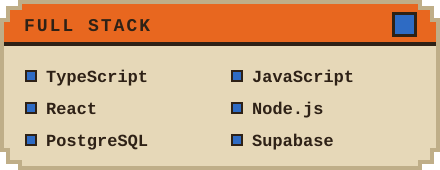
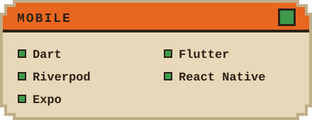
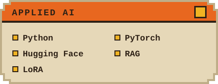
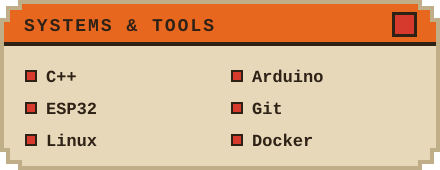

I build mobile wallets and study tools, and sometimes write code that walks around on twelve servos. My research at the intersection of software and medicine asks how hospitals can train a shared model while keeping MRI scans on site.

**Open to** backend and mobile engineering roles and federated learning collaborations.
<!-- Add a way to reach you here: email, LinkedIn, or both. -->

## Selected repositories

<table>
  <tr>
    <td width="50%" valign="top">
      <strong><a href="https://github.com/Shaswata28/StudyMate">StudyMate</a></strong> 
      Ask a question about your course notes and retrieve the passages that answer it. 
      Document retrieval · Local language models
    </td>
    <td width="50%" valign="top">
      <strong><a href="https://github.com/Shaswata28/DeltaCoinMobile">DeltaCoin</a></strong> 
      Scan a QR code to pay a peer and track spending in a mobile wallet. 
      React Native · Expo · Supabase
    </td>
  </tr>
  <tr>
    <td width="50%" valign="top">
      <strong><a href="https://github.com/Shaswata28/Momentum">Momentum</a></strong> 
      Log routines and expenses offline, then review the week in one place. 
      Flutter · Riverpod · Hive
    </td>
    <td width="50%" valign="top">
      <strong><a href="https://github.com/Shaswata28/SPYDER-Robot">S.P.Y.D.E.R.</a></strong> 
      Steer a twelve-servo quadruped while watching its live camera feed. 
      Arduino Nano · ESP32-CAM · C++
    </td>
  </tr>
</table>

## Research

How much data do hospitals need to exchange to train a model that can outline a brain tumor on an MRI? I’m comparing ways to combine locally trained model updates, including FedAvg, FedProx, and low-rank aggregation, across sites with different patient data.

## Skills

  
  &nbsp;&nbsp;&nbsp;
  
   
  
  &nbsp;&nbsp;&nbsp;
  

## Behind the lens

As convenor of the **East Delta University Photography Club**, I coordinated creative teams and sponsors for a national photography contest and exhibition.

## GitHub activity

<picture>
  <source media="(prefers-color-scheme: dark)" srcset="https://raw.githubusercontent.com/Shaswata28/Shaswata28/output/github-snake-dark.svg">
  
</picture>
